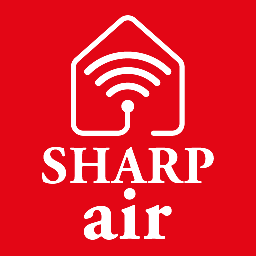

  

<h1 align="center">Sharp Air Egypt</h1>

  
  
  

Control the Sharp air conditioners you use with the **SHARP Air Control** app (Egypt) right from Home Assistant.

## What it does

Each indoor unit shows up as its own device with:

- **Climate control:** on/off, Cool and Fan only modes (Heat, Dry and Auto are untested), target temperature from 16 to 30 °C, and fan speed (Auto, Quiet, Very weak, Weak, Strong)
- **Sensors:** room temperature, humidity and outdoor temperature (the outdoor value holds its last reading for up to 6 hours while the AC is off)
- **Power and energy:** live watts and total kWh for the Energy dashboard (readings not yet checked against a meter)
- **Plasmacluster** on/off switch
- **Status:** Super Jet and fault indicators

Airflow (vane) positions and half-degree steps are available behind **Configure → Enable experimental controls**. They're off by default.

## Install (HACS)

1. In Home Assistant, open **HACS**.
2. Open the ⋮ menu and choose **Custom repositories**.
3. Add `https://github.com/Omarhkhater/sharp-cloud-python` as an **Integration**.
4. Search for **Sharp Air Egypt** and download it.
5. Restart Home Assistant.

Requires Home Assistant 2025.1 or newer. The logo appears on Home Assistant 2026.3 and newer.

Manual install: copy `custom_components/sharp_cocoro_air` into your `config/custom_components/` folder and restart.

## Set up

1. Go to **Settings → Devices & services → Add integration → Sharp Air Egypt**.
2. Open the sign-in link shown in the form and sign in with your SHARP Air Control account.
3. The browser ends on a page that won't load (`https://sharp-cocoroair-egypt/?code=…`). That's expected.
4. Copy that full address, paste it into the form, and submit.

Your password never reaches Home Assistant. Each sign-in link works once, so if setup fails, open the link again.

## Supported models

Tested on the **AY-XP12YHE** and **AY-XP18YHE**. Other Sharp ACs in the Egypt SHARP Air Control app may work but are untested. Let us know how yours does!

## Limitations

- **Cloud only.** It works through Sharp's Egypt cloud (polled about every minute) and needs an internet connection. There's no local control.
- **Super Jet is read-only.** Use the remote to switch it.
- **No Sharp timers.** Use Home Assistant automations or schedules instead.
- **Room readings freeze while the AC is off.** Sharp's cloud caches room temperature and humidity until the unit is turned back on.
- **Unofficial project.** It isn't affiliated with or endorsed by Sharp Corporation or El Araby Group.

## Help and issues

Found a bug or tested a new model? [Open an issue](https://github.com/Omarhkhater/sharp-cloud-python/issues). **Never post** passwords, cookies, tokens, sign-in or redirect URLs, or device IDs.

## License

[MIT](LICENSE) © 2026 Omar Khater
